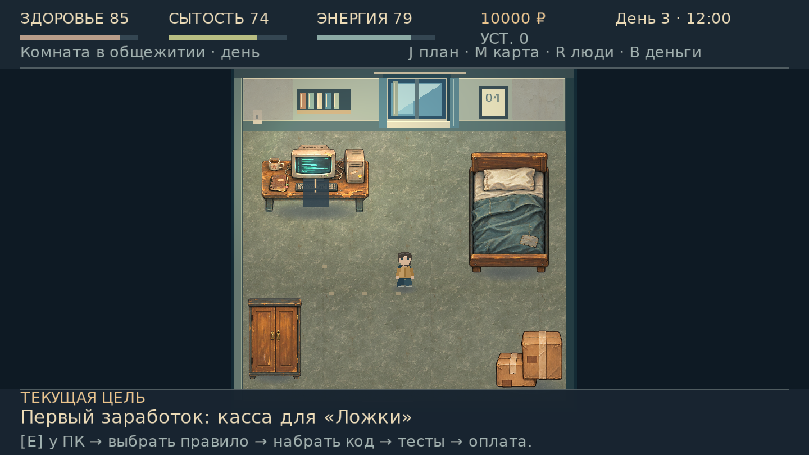
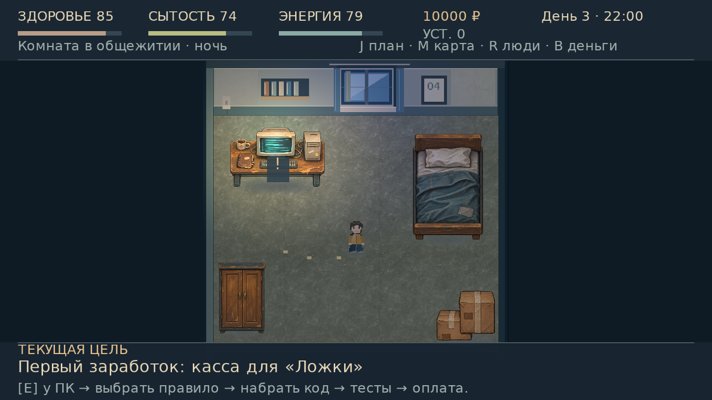
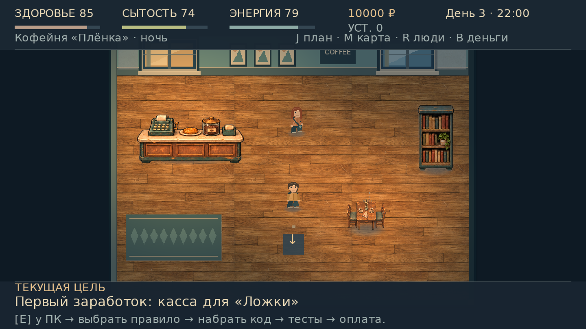
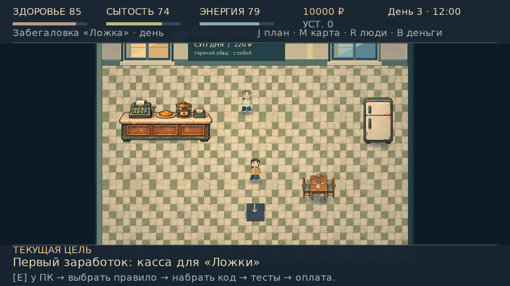
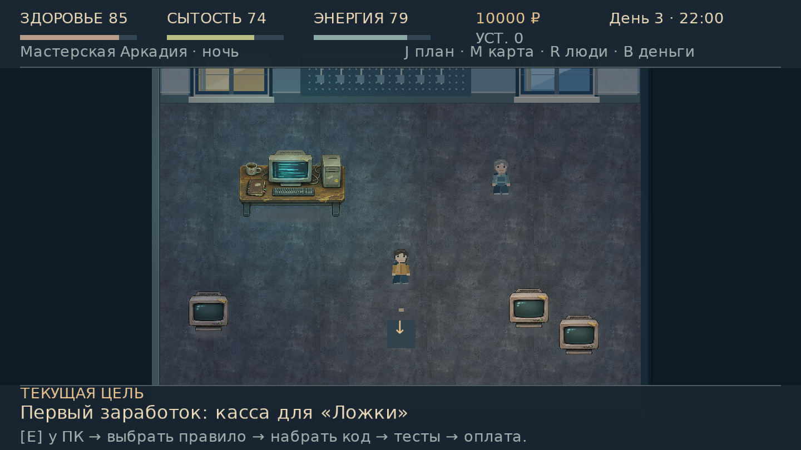
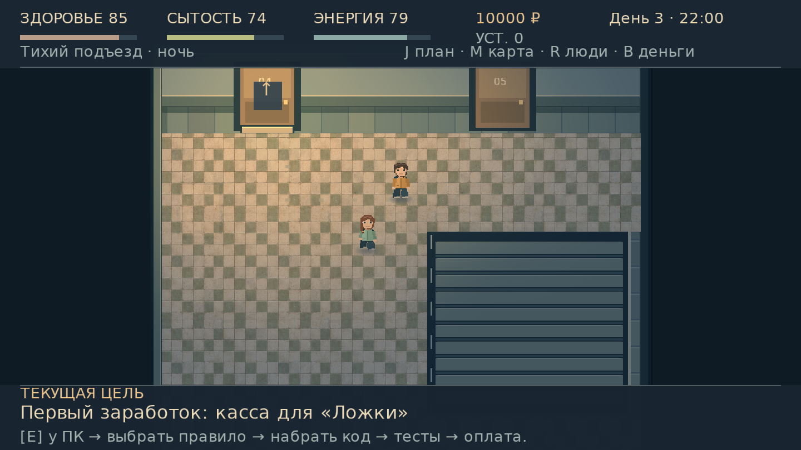
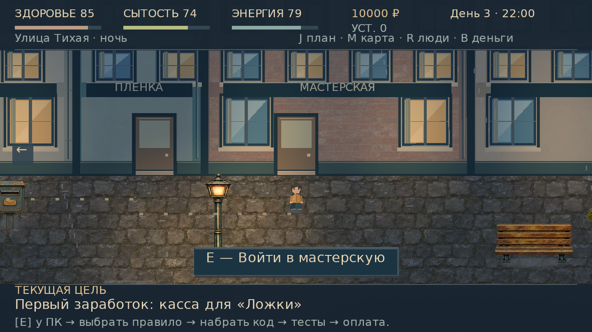
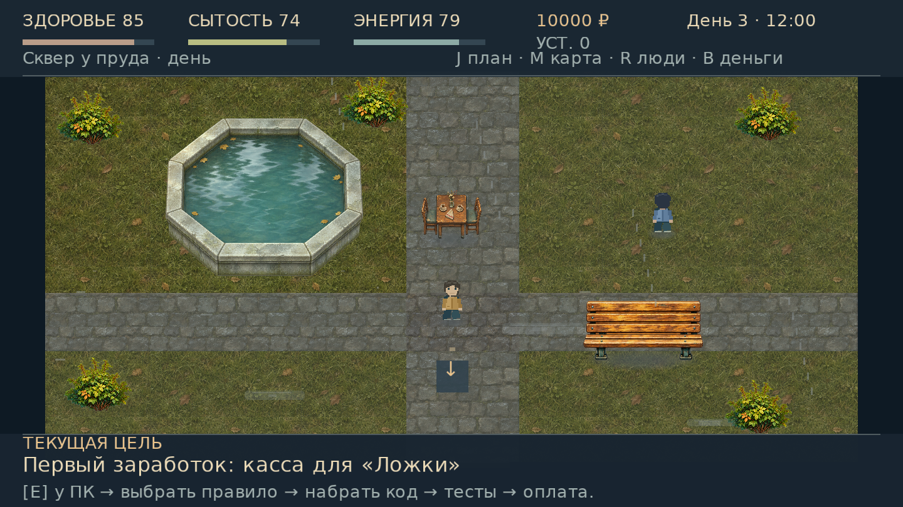
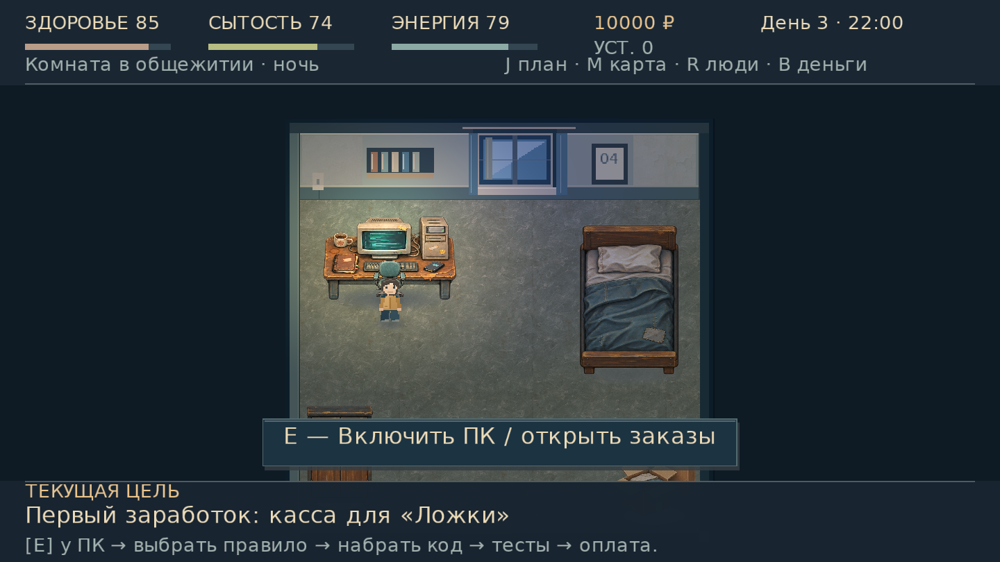

# Графика 0.10.0: кадры из игры

Снимки настоящего LWJGL3 backend, без ретуши. Для сопоставления времени суток, света и объектов используются отмеченные состояния VisualSmoke; это не кадры непрерывного прохождения. Основные снимки — 1440×810, ниже есть другие размеры окна.

## Комната днём и ночью

## Кофейня и «Ложка»

## Мастерская и подъезд

## Улица и сквер

## Подход к ПК и перекрытия

[За холодильником](screenshots/warm-light/fridge-behind.png) · [Перед холодильником](screenshots/warm-light/fridge-front.png) · [Перед деревом](screenshots/warm-light/tree-front.png)

## Размеры окна

[960×540: комната](screenshots/warm-light/room-size-960.png) · [1280×800: сквер, поля без растяжения](screenshots/warm-light/park-size-1280.png) · [1920×1080: улица](screenshots/warm-light/street-size-1920.png)

[Полная проверка](WARM_LIGHT_QA.md)
