# Свой ритм — реальные кадры 0.8.0

Скриншоты получены из запущенной игры. Нижняя часть прокручиваемой страницы снята после прокрутки, без редактирования изображения.

## layout-1280-max-page-12.png

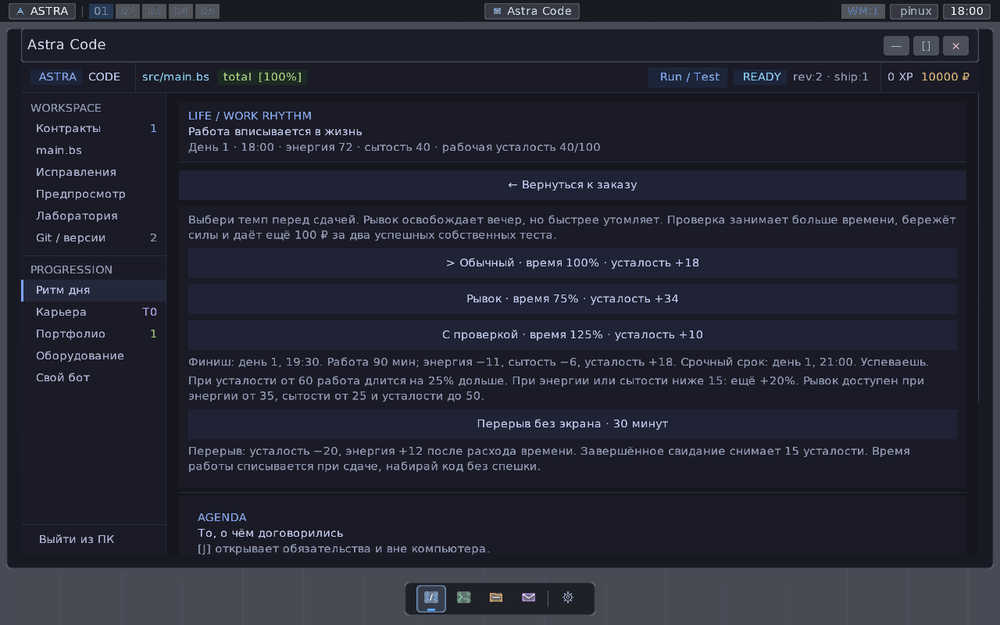

## layout-1920-max-page-12-lower.png

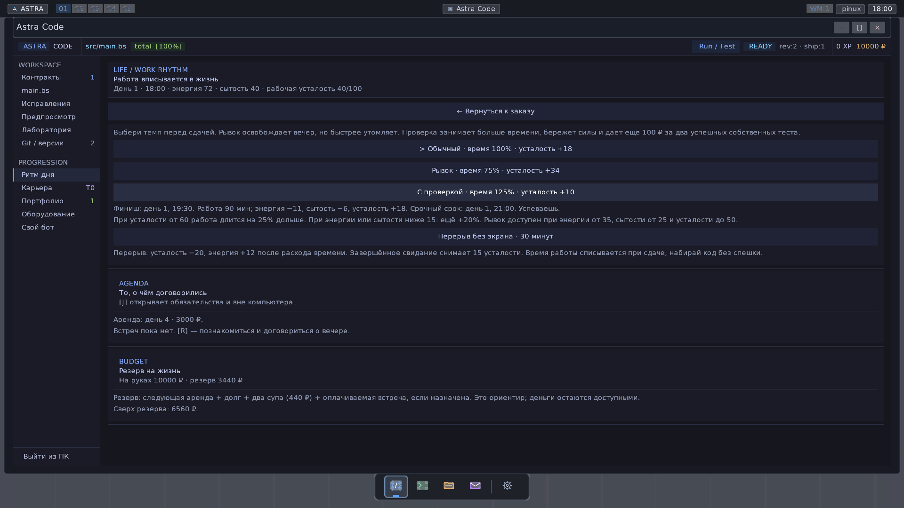

## layout-960-max-page-4-lower.png

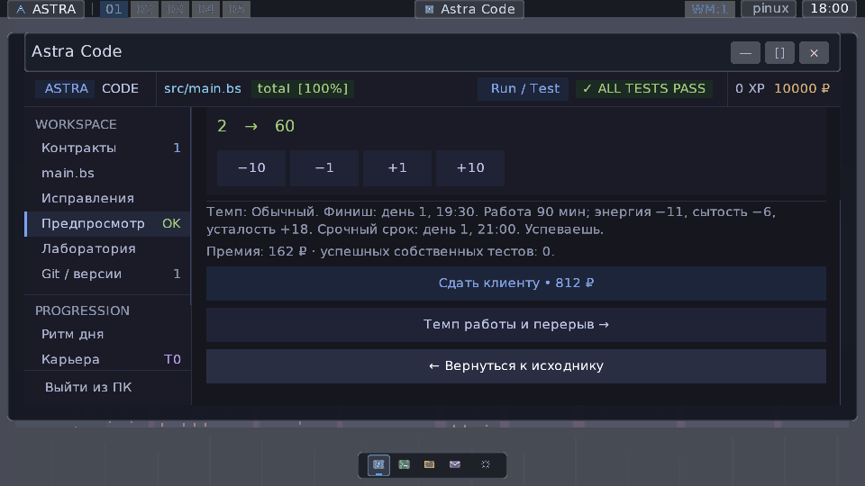

## layout-960-window-page-12-lower.png

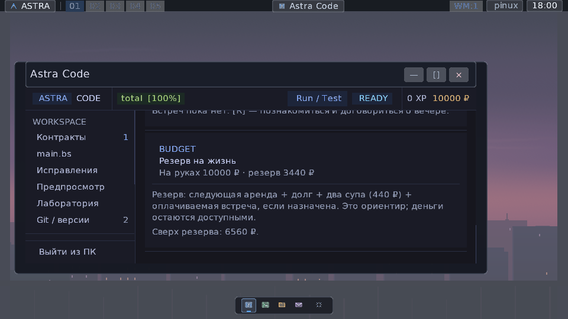

## layout-rhythm-break.png

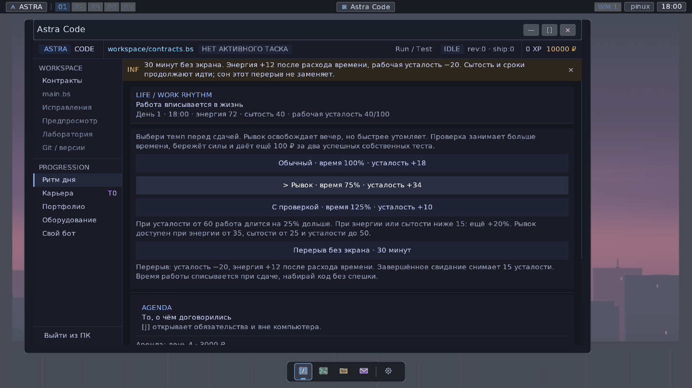

## rhythm-960-rest.png

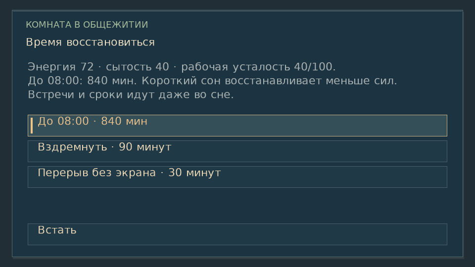

## rhythm-1280-agenda.png

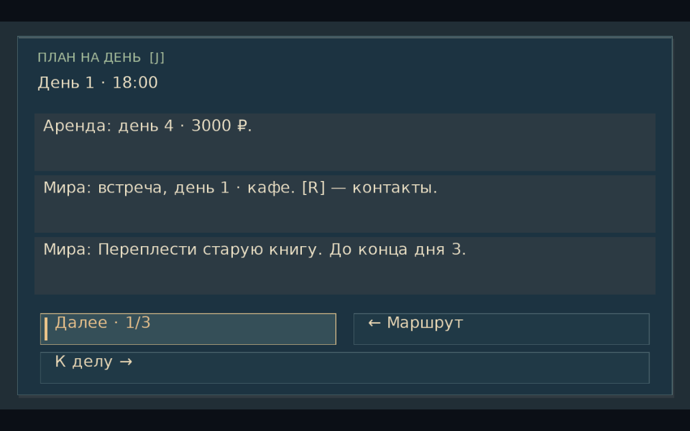

## rhythm-1920-agenda-next.png

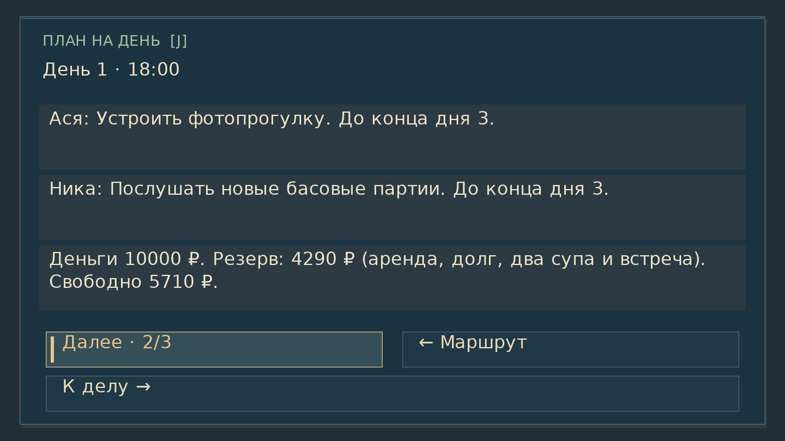

## rhythm-960-agenda-last.png

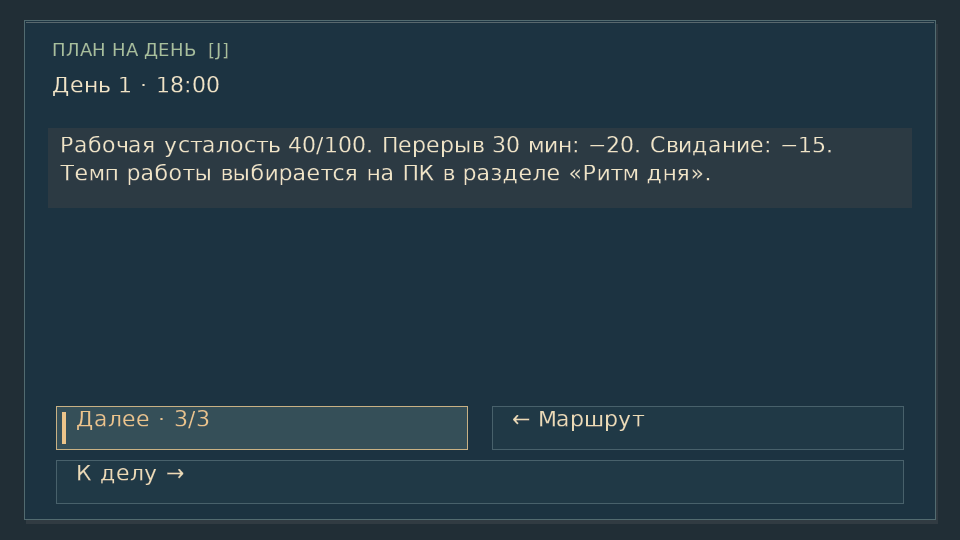

## rhythm-960-journal.png

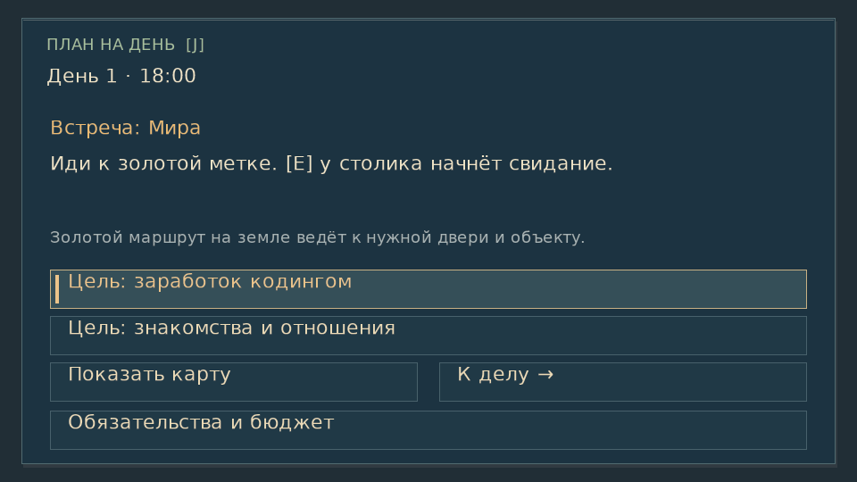

## rhythm-nap-result.png

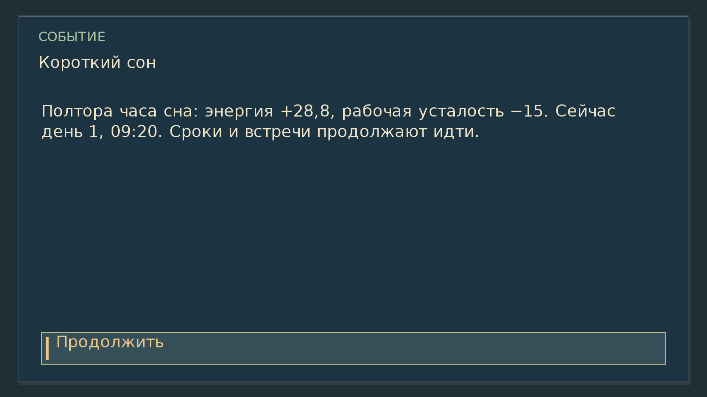

## rhythm-short-sleep.png

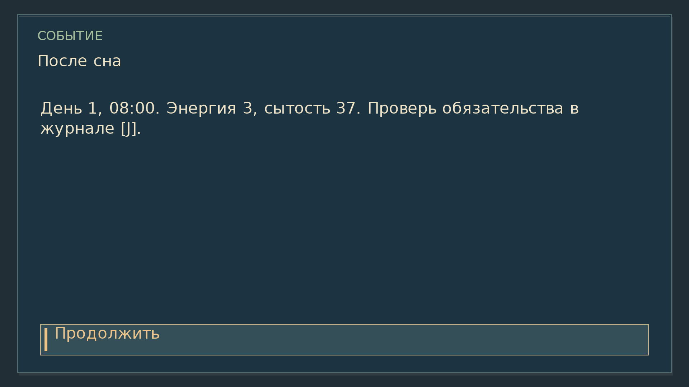

## HUD

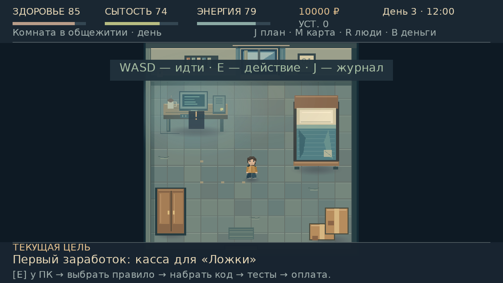
