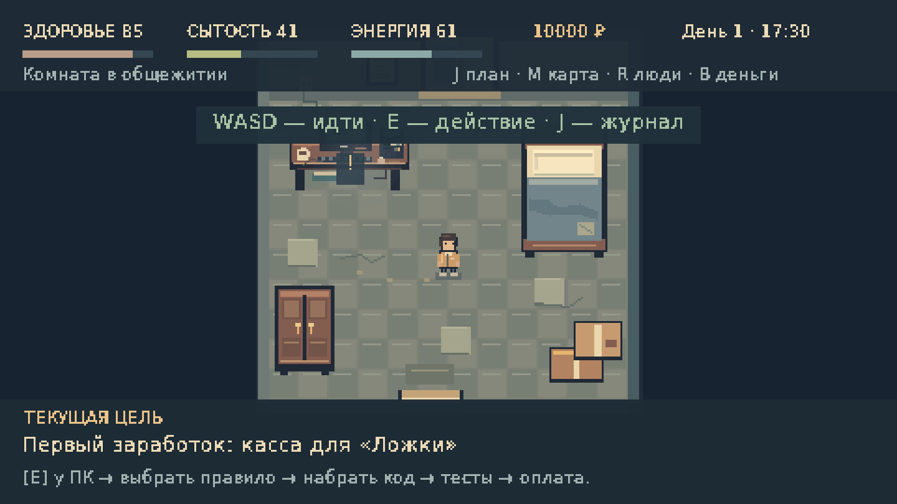
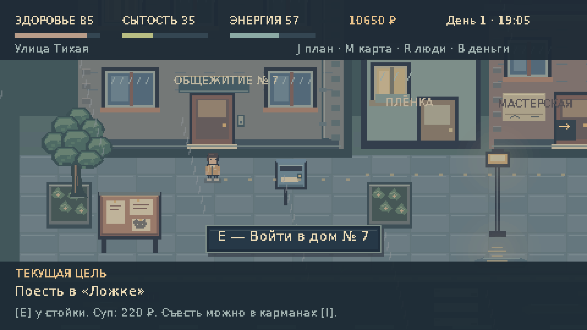
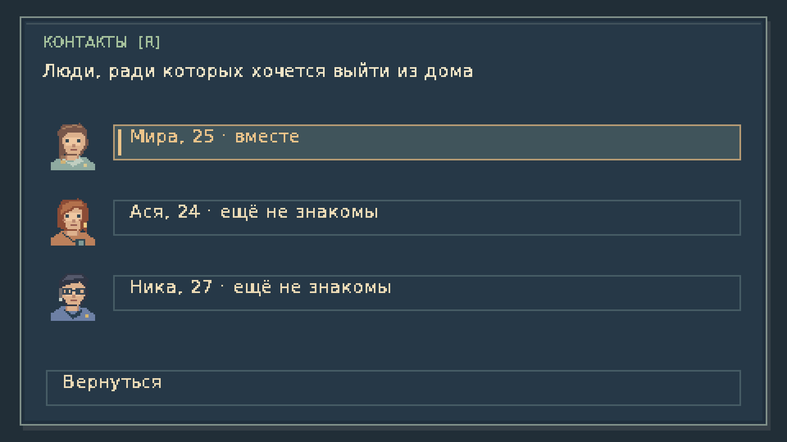

# CTRL+LIFE 0.2.0

[Скачать Windows x64 с Java внутри](https://github.com/IZKGMD/AutoGDBot/raw/refs/heads/ctrl-life/downloads/CTRL-LIFE-0.2.0-Windows-x64.zip)

[Скачать исходники](https://github.com/IZKGMD/AutoGDBot/raw/refs/heads/ctrl-life/downloads/CTRL-LIFE-0.2.0-source.zip)

Извлеките весь Windows ZIP и запустите `run.bat`. Для нового вступления выберите «Новая игра». Java уже включена. Требуется OpenGL 2.0. Запуск на Windows пока не проверен; графические проверки проведены на Linux.

В версии 0.2: маршрутка и 10 000 ₽ на старте, тесная комната, пошаговое обучение и маршрут, семь локаций, три заказа с настоящими тестами кода, еда/сон/аренда, бюджет, знакомства с тремя девушками, подарки, свидания, отношения и вечер вдвоём с затемнением.

Контрольные суммы — `SHA256SUMS.txt`. Проверки и ограничения — [QA](../docs/QA.md). Исходники игры расположены в ветке `ctrl-life`; основная ветка AutoGDBot не изменяется.
