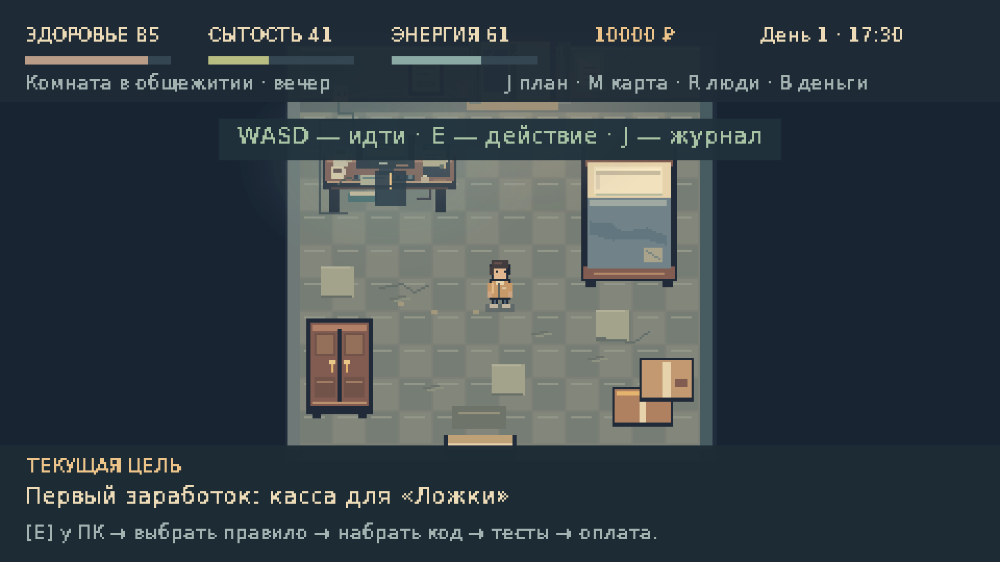
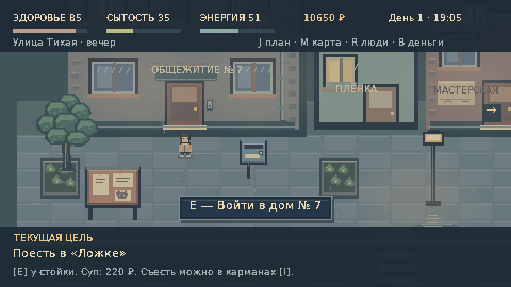
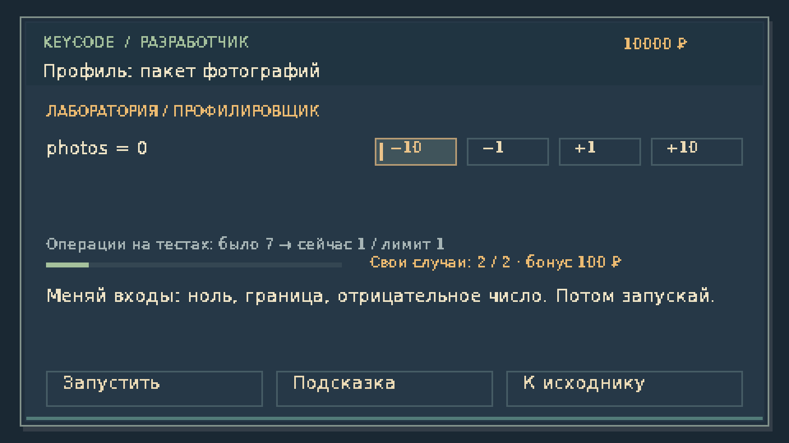
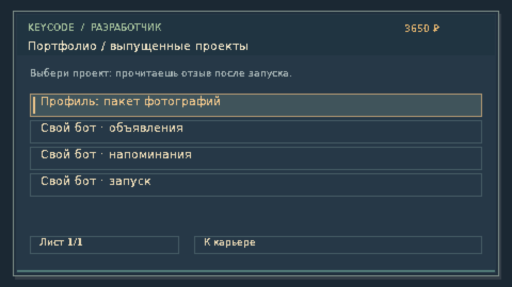

# CTRL+LIFE 0.3.0

[Скачать Windows x64 с Java внутри](https://github.com/IZKGMD/AutoGDBot/raw/refs/heads/ctrl-life/downloads/CTRL-LIFE-0.3.0-Windows-x64.zip)

[Скачать исходники](https://github.com/IZKGMD/AutoGDBot/raw/refs/heads/ctrl-life/downloads/CTRL-LIFE-0.3.0-source.zip)

Извлеките весь Windows ZIP и запустите `run.bat`. Java уже включена. Требуется OpenGL 2.0. Запуск на Windows пока не проверен; графические проверки проведены на Linux. Сохранения v1/v2 мигрируют; для нового вступления выберите «Новая игра».

В версии 0.3: карьера разработчика, девять клиентских задач и три этапа своего бота. Баги, оптимизация, свои тесты, коммиты и откаты, отзывы и портфолио. SSD и кресло меняют время работы и усталость. Смена освещения, локальный свет, ясные/дождливые дни и более подробное окружение.

На старте по-прежнему маршрутка, 10 000 ₽ и тесная комната. Работают пошаговые цели, семь локаций, еда, сон, аренда и бюджет; знакомства с тремя девушками, подарки, свидания и отношения.

Контрольные суммы — `SHA256SUMS.txt`. Проверки и ограничения — [QA](../docs/QA.md). Исходники игры расположены в ветке `ctrl-life`; основная ветка AutoGDBot не изменяется.
