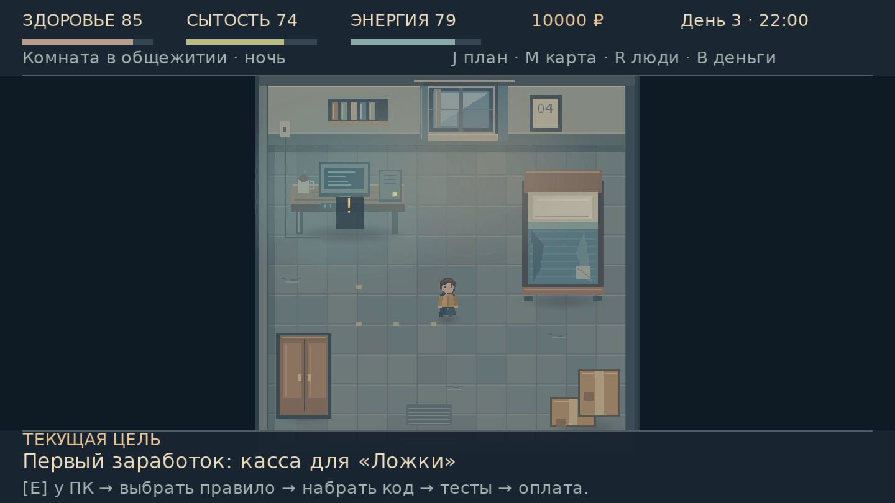
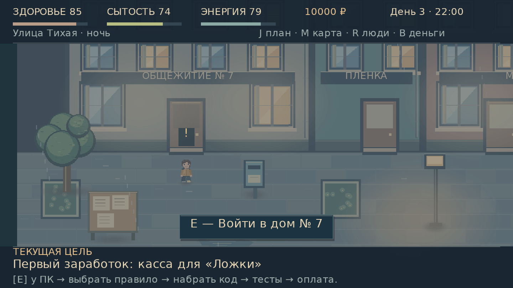
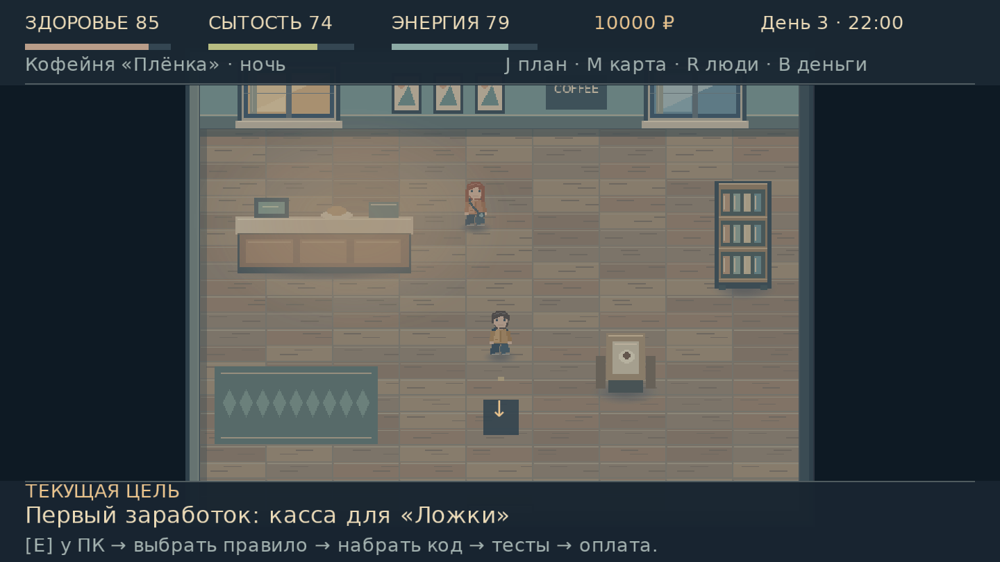
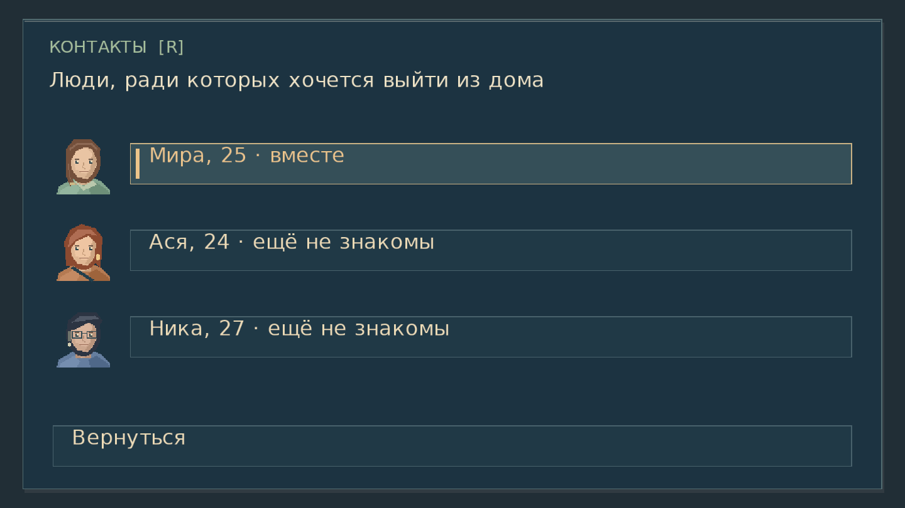

# CTRL+LIFE 0.6.0

[Скачать полную Windows-сборку с Java на GitHub](https://github.com/IZKGMD/AutoGDBot/releases/tag/v0.6.0-relationships) · [Что нового в отношениях](../docs/RELATIONSHIPS.md)

# Актуальная Pinux Astra

[Новые сборки 0.5.1 — GitHub Releases](https://github.com/IZKGMD/AutoGDBot/releases) · [Проверки](../docs/PINUX_AUDIT_QA.md) · [План развития](../TODO/ROADMAP.md)

Ниже сохранена предыдущая сборка 0.4.0.

# CTRL+LIFE 0.4.0

[Скачать Windows x64 с Java внутри](https://github.com/IZKGMD/AutoGDBot/raw/refs/heads/ctrl-life/downloads/CTRL-LIFE-0.4.0-Windows-x64.zip)

[Скачать исходники](https://github.com/IZKGMD/AutoGDBot/raw/refs/heads/ctrl-life/downloads/CTRL-LIFE-0.4.0-source.zip)

Распакуйте весь ZIP и запустите `run.bat`. Java уже включена. Требуется OpenGL 2.0. Запуск на Windows пока не проверен; графические проверки проведены в Linux. Старые сохранения мигрируют с сохранением прогресса.

Версия 0.4 посвящена графике: семь новых фонов, более подробная мебель, персонажи и портреты, чёткая типографика и компактный HUD. Свет, тени и дождь ограничены границами сцен. Вывески не пересекают окна; новые предметы имеют коллизии и правильно перекрывают персонажа. Карта показывает мебель. Проверены разные размеры окна, включая 1280×800 с полями.

Игровые системы 0.3 сохранены: карьера разработчика, девять клиентских задач, три этапа бота, тесты, профилировщик, версии кода, улучшения ПК; еда, аренда и отношения с тремя девушками.

[Все кадры визуальной проверки](../docs/screenshots/visual) · [Проверки и ограничения](../docs/QA.md)

Контрольные суммы — `SHA256SUMS.txt`. Игра находится в ветке `ctrl-life`; основная ветка AutoGDBot не изменяется.
